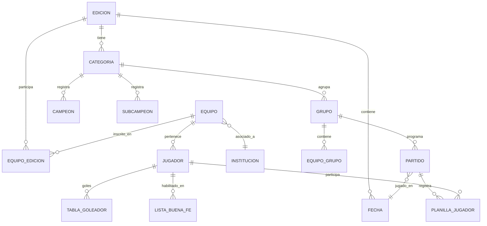
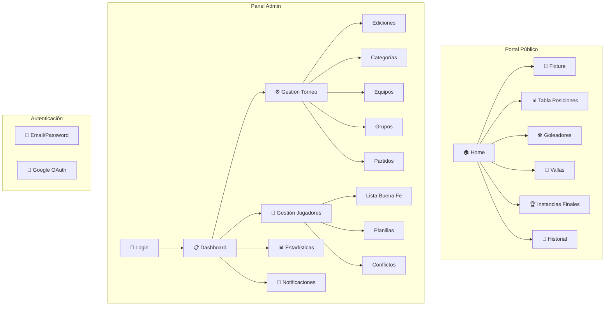
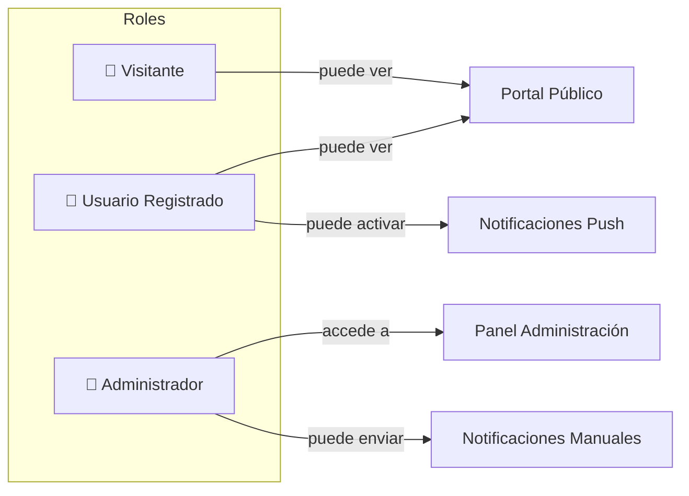

# 🏆 Torneo Mitai - Sistema de Gestión de Torneos de Fútbol Infantil

<p align="center">
  
</p>

<p align="center">
  <strong>Sistema web para la gestión integral de torneos de fútbol formativo</strong>
</p>

<p align="center">
  <a href="https://torneosmitai.com" target="_blank">🌐 Ver Sitio en Producción</a> •
  <a href="#instalación">📦 Instalación</a> •
  <a href="#funcionalidades">⚙️ Funcionalidades</a>
</p>

---

## 📋 Descripción

**Torneo Mitai** es una aplicación web desarrollada en Laravel que permite gestionar torneos de fútbol infantil de manera integral. Ofrece tanto una interfaz pública para que los usuarios consulten fixtures, tablas de posiciones, goleadores y resultados, como un panel de administración completo para la gestión de equipos, jugadores, partidos y estadísticas.

---

## 🛠️ Stack Tecnológico

| Categoría | Tecnología |
|-----------|------------|
| **Backend** | PHP 8.3, Laravel 11 |
| **Frontend** | Blade, TailwindCSS, Alpine.js |
| **Base de Datos** | MySQL |
| **Autenticación** | Laravel Breeze, Google OAuth (Socialite) |
| **Notificaciones** | Web Push Notifications (VAPID) |
| **PDF** | DomPDF |
| **Build Tool** | Vite |
| **Testing** | Pest |
| **Contenedores** | Docker (opcional) |

---

## ⚙️ Funcionalidades

### 🌐 Portal Público

| Funcionalidad | Descripción |
|---------------|-------------|
| **Página Principal** | Selección de edición activa y accesos directos a todas las secciones |
| **Fixture** | Visualización de partidos por categoría, fecha y horario con resultados |
| **Tabla de Posiciones** | Clasificación de equipos por grupo con puntos, partidos jugados, goles a favor/contra |
| **Tabla de Goleadores** | Ranking de goleadores en tiempo real con goles y asistencias |
| **Vallas Menos Vencidas** | Ranking de equipos con menos goles recibidos (arqueros destacados) |
| **Instancias Finales** | Bracket de playoffs con resultados de cuartos, semis y finales |
| **Historial de Campeones** | Registro histórico de campeones por categoría y edición |
| **Historial de Subcampeones** | Registro histórico de subcampeones |  
| **Goleadores Históricos** | Máximos goleadores por edición |
| **Vallas Históricas** | Mejores vallas invictas por edición |

### 🔐 Panel de Administración

#### Gestión del Torneo

| Módulo | Descripción |
|--------|-------------|
| **Ediciones** | Crear, editar y gestionar diferentes ediciones del torneo (ABM completo) |
| **Categorías** | Administrar categorías de edad (Sub-8, Sub-10, Sub-12, etc.) |
| **Equipos** | Registro de equipos con foto, nombre e institución asociada |
| **Grupos/Zonas** | Organización de equipos en grupos para la fase regular |
| **Fechas** | Programación de jornadas de partidos |
| **Copas** | Gestión de diferentes copas dentro de cada edición |
| **Fases** | Configuración de fases del torneo (grupos, eliminatorias) |

#### Gestión de Partidos

| Módulo | Descripción |
|--------|-------------|
| **Partidos** | Creación y programación de partidos con fecha, hora y cancha |
| **Carga de Resultados** | Registro de marcadores con validación automática |
| **Planillas de Jugadores** | Gestión de jugadores que participan en cada partido |
| **Instancias Finales** | Administración del cuadro de eliminatorias |

#### Gestión de Jugadores

| Módulo | Descripción |
|--------|-------------|
| **Lista de Buena Fe** | Registro oficial de jugadores habilitados por equipo y edición |
| **Consulta de Jugador** | Búsqueda global de jugadores con historial de participación |
| **Revisión de Conflictos** | Gestión de jugadores con datos conflictivos o duplicados |
| **Migración de Jugadores** | Herramienta para migrar datos de jugadores entre ediciones |
| **Estadísticas de Jugadores** | Dashboard con métricas globales por edición (goles, asistencias, tarjetas) |

#### Gestión de Datos Históricos

| Módulo | Descripción |
|--------|-------------|
| **Campeones** | Registro de equipos campeones por categoría |
| **Subcampeones** | Registro de equipos subcampeones |
| **Goleadores del Torneo** | Registro de máximos goleadores por edición |
| **Vallas Menos Vencidas** | Registro de mejores defensas por edición |
| **Tabla de Goleadores** | Gestión manual de la tabla de goleadores |

#### Instituciones

| Módulo | Descripción |
|--------|-------------|
| **Gestión de Instituciones** | Crear, editar y asociar instituciones a equipos |
| **Vinculación de Equipos** | Asociar/desvincular equipos de instituciones |

### 🔔 Notificaciones Push

| Funcionalidad | Descripción |
|---------------|-------------|
| **Suscripción de Usuarios** | Los usuarios pueden activar notificaciones desde el menú |
| **Notificaciones Automáticas** | Alertas al cargar resultados de partidos |
| **Envío Manual (Admin)** | Envío de notificaciones personalizadas desde el panel |
| **Notificaciones Rápidas** | Botones predefinidos: "Fixture Cargado", "Goleadores Actualizados" |
| **Rate Limiting** | Protección contra abuso en endpoints de suscripción |

### 📊 Reportes y Exportación

| Funcionalidad | Descripción |
|---------------|-------------|
| **PDF de Lista de Buena Fe** | Exportación de planillas oficiales en PDF |
| **Reporte de Jugadores** | Generación de reportes de jugadores por partido |
| **Planillas Imprimibles** | Formato optimizado para impresión de planillas de partido |

---

## 🏛️ Arquitectura

### Diagrama de Entidades Principal



### Diagrama de Flujo del Sistema



### Roles de Usuario



---

## 📦 Instalación

### Requisitos Previos

- PHP >= 8.3
- Composer
- Node.js >= 18
- MySQL >= 8.0

### Instalación Local

```bash
# Clonar repositorio
git clone https://github.com/Facudominguez7/Torneo-Mitai.git
cd Torneo-Mitai-Laravel

# Instalar dependencias PHP
composer install

# Instalar dependencias Node.js
npm install

# Copiar archivo de configuración
cp .env.example .env

# Generar clave de aplicación
php artisan key:generate

# Configurar base de datos en .env
# DB_CONNECTION=mysql
# DB_HOST=127.0.0.1
# DB_PORT=3306
# DB_DATABASE=torneo_mitai
# DB_USERNAME=root
# DB_PASSWORD=

# Ejecutar migraciones
php artisan migrate

# Generar claves VAPID para push notifications
php artisan webpush:vapid

# Compilar assets
npm run build

# Iniciar servidor de desarrollo
php artisan serve
```

### Instalación con Docker

```bash
# Usar el script de inicio
./docker-start.sh

# O manualmente
docker-compose up -d
```

> 📖 Ver [DOCKER.md](DOCKER.md) para documentación detallada de Docker.

---

## 🔧 Configuración

### Variables de Entorno Principales

```env
# Aplicación
APP_NAME="Torneo Mitai"
APP_URL=http://localhost:8000

# Base de Datos
DB_CONNECTION=mysql
DB_HOST=127.0.0.1
DB_PORT=3306
DB_DATABASE=torneo_mitai

# Google OAuth
GOOGLE_CLIENT_ID=your_client_id
GOOGLE_CLIENT_SECRET=your_client_secret
GOOGLE_REDIRECT_URI=http://localhost:8000/auth/google/callback

# Push Notifications (VAPID)
VAPID_PUBLIC_KEY=your_public_key
VAPID_PRIVATE_KEY=your_private_key
```

---

## 🧪 Testing

```bash
# Ejecutar tests con Pest
php artisan test

# O usando Pest directamente
./vendor/bin/pest
```

---

## 📁 Estructura del Proyecto

```
├── app/
│   ├── Http/Controllers/
│   │   ├── ControladorHome.php          # Páginas públicas
│   │   ├── ControladorNotificacionesPush.php
│   │   └── Panel/                        # Controladores del admin
│   │       ├── ControladorEquipo.php
│   │       ├── ControladorPartidos.php
│   │       ├── ControladorListaBuenaFe.php
│   │       └── ...
│   ├── Models/
│   │   ├── Edicion.php
│   │   ├── Equipo.php
│   │   ├── Jugador.php
│   │   ├── Partido.php
│   │   └── ...
│   └── Notifications/
│       ├── ResultadoCargado.php
│       └── NotificacionPersonalizada.php
├── resources/views/
│   ├── welcome.blade.php                 # Página principal
│   ├── Panel/                            # Vistas del admin
│   │   ├── admin.blade.php
│   │   └── ...
│   └── layouts/
│       └── navigation.blade.php
├── routes/
│   └── web.php                           # Rutas de la aplicación
├── database/
│   └── migrations/                       # Migraciones de BD
└── public/
    └── fotos/                            # Imágenes de equipos y assets
```

---

## 🚀 Despliegue

El proyecto está configurado para despliegue automático en Hostinger mediante GitHub Actions.

### CI/CD Pipeline

1. Push a la rama `main`
2. GitHub Actions ejecuta build de assets
3. Deploy automático via SSH/SFTP
4. Cache clearing y optimización

---

## 👥 Contribución

1. Fork del repositorio
2. Crear rama feature (`git checkout -b feature/nueva-funcionalidad`)
3. Commit de cambios (`git commit -m 'Agregar nueva funcionalidad'`)
4. Push a la rama (`git push origin feature/nueva-funcionalidad`)
5. Crear Pull Request

---

## 👨‍💻 Autor

**Facundo Díaz Domínguez**

- 🔗 [LinkedIn](https://www.linkedin.com/in/facundo-diaz-dominguez-0a826b230)
- 🌐 [torneosmitai.com](https://torneosmitai.com)

---

<p align="center">
  <sub>Hecho con ❤️ para el fútbol formativo</sub>
</p>
