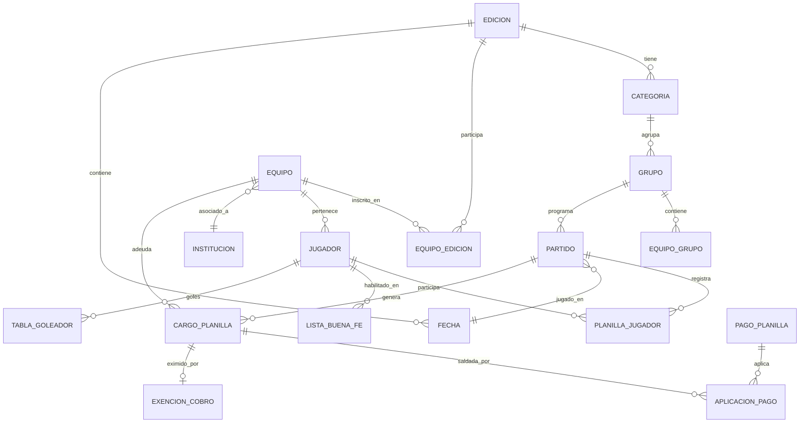

# 🏆 Torneo Mitai

<p align="center">
  
</p>

<p align="center">
  <a href="https://torneosmitai.com">🌐 torneosmitai.com</a> •
  <a href="#instalación">📦 Instalación</a> •
  <a href="#arquitectura">🏛️ Arquitectura</a> •
  <a href="#licencia">📜 Licencia</a>
</p>

Sistema web en **Laravel 11** para la gestión integral de torneos de fútbol infantil: portal público de consulta (fixture, posiciones, goleadores, vallas, instancias finales, campeones e historial) y panel de administración completo (ediciones, equipos, partidos, planillas, listas de buena fe, cobros de planillas y notificaciones por email).

## 🛠️ Stack

PHP 8.3 · Laravel 11 · Blade · TailwindCSS · Alpine.js · MySQL · DomPDF · Vite · Pest · Docker (opcional)

## ⚙️ Funcionalidades

- **Portal público**: fixture por categoría y fecha, tablas de posiciones, goleadores y vallas, instancias finales, campeones, subcampeones y premiados por edición. Incluye SEO (títulos, canónicas, Open Graph, `sitemap.xml` y `robots.txt`).
- **Cuentas y notificaciones**: registro e ingreso con email o Google, verificación de email, aceptación de términos y política de privacidad. Los usuarios siguen a un equipo y reciben por email el resumen de resultados de cada fecha, con baja en un clic.
- **Planilla de partido**: tabla por equipo en el orden de la lista de buena fe, buscador por DNI o nombre, autoguardado por jugador con aviso y reintento si falla, goles arbitrales y planillas públicas con enlace propio.
- **Cobros de planillas**: cargo por equipo y partido con tarifa configurable, pagos en efectivo, Mercado Pago o combinados, saldo a favor, exenciones por partido o por edición y deudas cargadas a mano. La planilla del partido muestra qué planillas debe cada equipo, y marcar que un equipo no vino le da el 3 a 0 al rival.
- **Panel admin**: gestión de ediciones, categorías, equipos e instituciones, grupos y fechas, resultados, reemplazo de equipos, listas de buena fe con revisión de conflictos, consulta de jugadores y estadísticas.
- **Reportes**: fixture, tablas, planillas de partido, cobros y listas de buena fe imprimibles en PDF.

## 📦 Instalación

Requisitos: PHP >= 8.3, Composer, Node.js >= 18, MySQL >= 8.0.

```bash
git clone https://github.com/Facudominguez7/Torneo-Mitai.git
cd Torneo-Mitai-Laravel
composer install && npm install
cp .env.example .env
php artisan key:generate
# Configurar credenciales de MySQL y Google OAuth en .env
php artisan migrate
npm run build
php artisan serve
```

Con Docker: `./docker-start.sh` — ver [DOCKER.md](DOCKER.md) para más detalle.

## 🧪 Testing

```bash
php artisan test    # o ./vendor/bin/pest
```

Con Docker, los comandos de PHP se ejecutan dentro del contenedor `app` (`docker compose exec app ./vendor/bin/pest`). Los tests modifican datos: correlos contra una base de pruebas, nunca contra la de desarrollo.

## 🏛️ Arquitectura



Despliegue automático a Hostinger vía GitHub Actions (push a `main` → build → deploy SSH).

## 📜 Licencia

Proyecto **privado y propietario**: todos los derechos reservados. La publicación del código no otorga licencia de uso. Ver [LICENSE](LICENSE).

## 👨‍💻 Autor

**Ing. Facundo Díaz Domínguez** — [LinkedIn](https://www.linkedin.com/in/facundo-diaz-dominguez-0a826b230) · [torneosmitai.com](https://torneosmitai.com)

<p align="center">
  <sub>Hecho con ❤️ para el fútbol formativo</sub>
</p>
